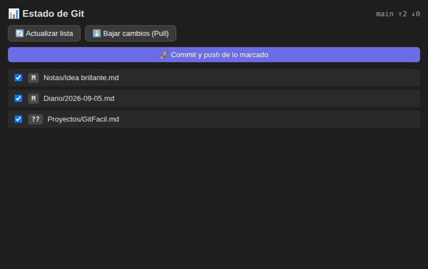

# GitFacil - Obsidian Plugin

[-brightgreen)](#-arquitectura-de-motor-dual--dual-engine)

**GitFacil** es el plugin oficial de Obsidian para respaldar y sincronizar tus notas con GitHub en **1 solo clic**, sin comandos complejos ni terminales. Diseñado para usuarios de todo tipo: desde principiantes que no saben programar hasta usuarios avanzados que buscan sincronización instantánea y confiable.

> **GitFacil** is an ultra-lightweight and simple Git backup plugin for Obsidian. One-click backup and bi-directional sync to GitHub with zero terminal fuss, on desktop and mobile.

📦 **Disponible en la tienda oficial de Obsidian:** [community.obsidian.md/plugins/git-facil](https://community.obsidian.md/plugins/git-facil)  
📖 **Manual completo y detallado / Full manual:** [MANUAL.md](MANUAL.md).

---

---

## 🌟 Características Principales / Key Features

| Característica / Feature | GitFacil | Plugin de Git Convencional |
| -------------------------------- | :---: | :---: |
| 🚀 **Respaldo en 1 clic (Commit & Push)** | ✅ | ⚠️ Complejo |
| 🔄 **Sincronización Completa (Pull + Push)** | ✅ | ❌ Múltiples comandos |
| 📱 **Móvil nativo (Android/iOS) sin Termux** | ✅ | ❌ Requiere Termux / CLI |
| 📶 **Detección offline inteligente (cero pánico)** | ✅ | ❌ Errores rojos alarmantes |
| 📥 **Clonar bóveda en 1 clic desde la app** | ✅ | ❌ Requiere clonar por terminal |
| 👁️ **Token GitHub seguro y enmascarado** | ✅ | ❌ Texto plano |
| 🪄 **Asistente paso a paso sin consola** | ✅ | ❌ Solo consola |
| 📊 **Panel lateral con checkboxes y Pull** | ✅ | ⚠️ Poco intuitivo |
| ⏳ **Respaldo programado (Auto-sync)** | ✅ | ✅ |

---

## ⚙️ Arquitectura de Motor Dual / Dual Engine

GitFacil adapta inteligentemente su motor al dispositivo que estés usando:

- **🖥️ En Escritorio (Windows / macOS / Linux):** Utiliza el ejecutable de Git nativo del sistema para máxima velocidad, compatibilidad con repositorios grandes y soporte para extensiones Git.
- **📱 En Móvil (Android / iOS):** Motor puro en JavaScript (`isomorphic-git`) optimizado con el adaptador de archivos de Obsidian (`vault.adapter`) y peticiones HTTP seguras (`requestUrl`). **¡Cero Termux, cero Node.js externo y cero configuraciones complejas!**

## 📥 Instalación y Uso / Installation & Usage

### 🚀 Inicio Rápido en 3 Minutos / 3-Minute Quickstart

### 1️⃣ Instala GitFacil
- Abre Obsidian -> **Ajustes (Settings)** -> **Community plugins**.
- Busca **GitFacil** y haz clic en **Instalar** y luego en **Activar**.

### 2️⃣ Genera tu Token de GitHub
- Ve a **Ajustes** -> **GitFacil**.
- Haz clic en **🔑 Generar Token en GitHub (1 Clic)** o entra directo a [GitHub New Token (repo scope)](https://github.com/settings/tokens/new?description=Obsidian+GitFacil&scopes=repo).
- Genera el token con permiso `repo`, cópialo y pégalo en la casilla de Token de GitFacil.
- Haz clic en **🧪 Probar Conexión** para confirmar que tu usuario de GitHub está conectado (`@tu-usuario`).

### 3️⃣ ¡Listo! Sincroniza tus Notas
- **Desde el icono del cohete 🚀 en la barra lateral:** Pulsa para guardar y subir tus cambios inmediatamente.
- **Desde la paleta de comandos (`Ctrl+P` / `Cmd+P`):**
  - `🔄 GitFacil: Sincronizar Bóveda Completa (Bajar cambios y Subir)`
  - `🚀 GitFacil: Commit y Push`
  - `📊 GitFacil: Abrir panel de Estado de Git`
  - `📥 GitFacil: Clonar Bóveda desde GitHub`

---

## 📶 Modo Offline Inteligente / Smart Offline Mode

¿Te quedaste sin internet en el metro, avión o zona sin cobertura?  
- **Sin alarmas:** GitFacil detecta automáticamente la falta de conexión (`isNetworkOrOfflineError`).
- **Tus notas están a salvo:** Registra tu commit localmente en el historial de Git y te notifica amigablemente:  
  *«📶 Sin conexión a internet. Tus notas quedaron guardadas localmente y se subirán al conectarte.»*
- En cuanto recuperes conexión, pulsa el cohete 🚀 o deja que el **Auto-sync** suba tus notas automáticamente.

---

## 📥 Clonar Bóveda en un Dispositivo Nuevo / Clone on New Device

¿Acabas de instalar Obsidian en tu celular o en otra computadora y quieres descargar todas tus notas?
1. Abre Obsidian y crea una bóveda vacía.
2. Instala y activa **GitFacil**.
3. Abre la paleta de comandos (`Ctrl+P`) y selecciona **📥 Clonar Bóveda desde GitHub**.
4. Pega la URL de tu repositorio (`https://github.com/usuario/mi-boveda.git`) y tu token.
5. Haz clic en **Clonar Bóveda**. ¡GitFacil descargará todas tus notas, carpetas y configuraciones al instante!

---

## 🔒 Privacidad y Seguridad de Red / Privacy & Security

- GitFacil opera **100% de forma local y directa** con tus repositorios de GitHub.
- **Sin intermediarios:** No existe ningún servidor, analítica ni telemetría de GitFacil.
- El token personal se utiliza exclusivamente para autenticarte frente a la API oficial de GitHub (`api.github.com`) y en los endpoints HTTPS de tu propio repositorio.
- El token se mantiene enmascarado en la interfaz de ajustes con botón de visibilidad (`eye` / `eye-off`).

---

## 📄 Licencia / License

Distribuido bajo la Licencia **MIT**. Consulta [LICENSE](LICENSE) para más detalles.  
Creado con ❤️ por [Alex Lazo (Alecwce)](https://github.com/Alecwce).
